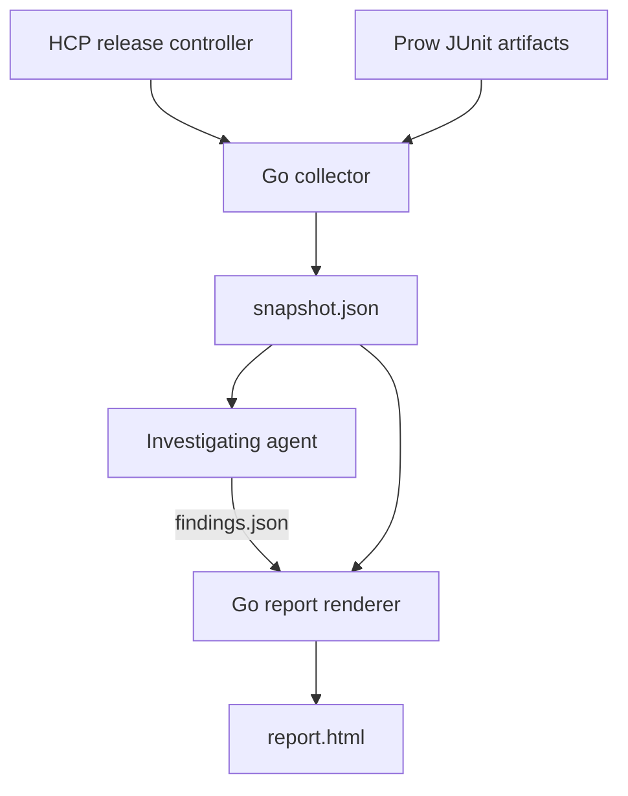

# HyperShift payload analysis

This skill explains why a blocking job failed for a HyperShift operator payload. It compares JUnit results across retries and earlier payloads, then cites the evidence for each finding.

OCP payload tooling investigates platform releases, including changes to RHCOS packages. HyperShift ships a separately versioned operator and tests it against multiple OCP release lines. This skill follows the operator's own release stream and the Prow jobs that gate it.

The CLI requires Go 1.26 or newer. See [SKILL.md](SKILL.md) for usage. For development, see the [contributor guidance](AGENTS.md) and run [`make test`](Makefile) from this directory.

## Design invariants

The pipeline is stateless across runs. Each stage takes its inputs explicitly.

- Collection is bounded and cancellable. The resulting snapshot preserves observed outcomes, source URLs, and collection errors.
- Investigation treats the snapshot as immutable. The agent records its diagnosis and any supplemental evidence from job logs or source diffs in the findings.
- Reporting validates the findings against the snapshot. The same two files must produce byte-identical HTML offline.

## Notes & Limitations

- The HyperShift Release Controller is still pre-production and contains few example payloads for analysis; this skill is also currently a POC to test end to end pipeline integrations and demonstrate a functional iteration path.
- Evals are limited due to lack of historical payloads and a process for retaining them. The current eval is a committed snapshot of a failed payload to demonstrate eval functionality and iteration.
- Snapshot storage format is subject to change: after multiple rounds of eval testing with SQLite (using multiple approaches including a typical schema, JSONB, and plain text JSON storage), the eval agent saw no measurable benefit vs. being provided access to the raw JSON blob, so for now the blob (while enormous) is simple and works.
